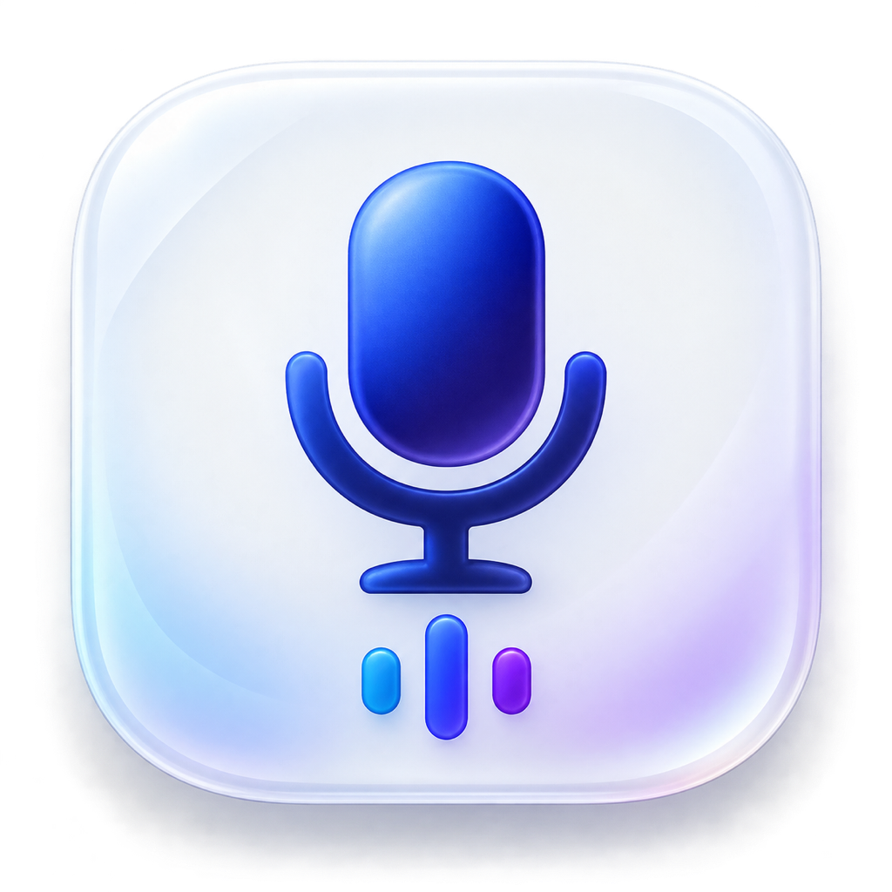
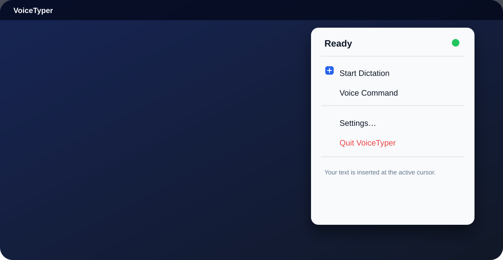
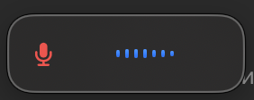
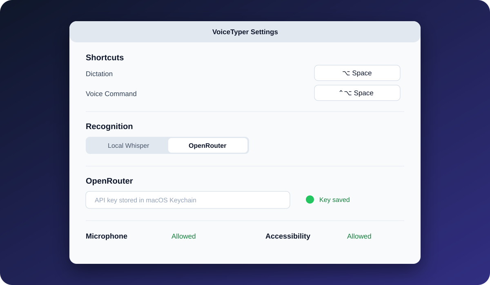

# VoiceTyper

<p align="center"></p>

<p align="center">A private, menu-bar voice typer for macOS.</p>

VoiceTyper turns speech into text and inserts it into the currently focused text field. It supports private on-device transcription with WhisperKit and optional cloud transcription through OpenRouter.

> Current releases are ad-hoc signed, not notarized by Apple. Each OpenRouter user supplies their own API key.

## Interface previews

The recording overlay below is an actual in-app screenshot. The other visual cards show the product flow without exposing personal windows or API keys.

| Menu bar controls | Compact recording overlay |
| :---: | :---: |
|  |  |

| Settings |
| :---: |
|  |

## Features

- Dictate into any macOS app and insert recognized text automatically.
- Configure global shortcuts for dictation and voice-command input.
- Hold a shortcut to talk and release it to finish, or tap once to start and once to stop.
- Choose local WhisperKit or OpenRouter transcription.
- Store the OpenRouter API key in the macOS Keychain, never in project files or UserDefaults.
- Keep audio local in WhisperKit mode; temporary recordings are deleted after processing.
- See a compact, centered recording overlay while the microphone is active.

## Install a release

1. Open [Releases](../../releases) and download `VoiceTyper-<version>-unsigned.zip`.
2. Unzip it and move `VoiceTyper.app` to **Applications**.
3. Control-click the app and choose **Open** for the first launch.
4. Grant **Microphone** and **Accessibility** access. Accessibility is required for automatic text insertion in other apps.
5. Click the VoiceTyper menu-bar icon, open **Settings**, and select a recognition mode:
   - **Local Whisper** keeps audio on the Mac. The multilingual model downloads on first use.
   - **OpenRouter** sends audio to OpenRouter. Enter your own API key; charges depend on your OpenRouter account.

If macOS still blocks the first launch, open **System Settings → Privacy & Security** and choose **Open Anyway** next to the VoiceTyper notice.

## Default shortcuts

| Action | Shortcut |
| --- | --- |
| Dictation | `⌥ Space` |
| Voice-command input | `⌃⌥ Space` |

Shortcuts can be changed in Settings. VoiceTyper detects conflicts and will not apply the same shortcut to both actions.

## Build from source

Requirements: macOS 14 or later, Xcode or Command Line Tools, and Swift 6.

```bash
swift build
swift test
swift run VoiceTyper
```

Create an application bundle:

```bash
./scripts/package-app.sh release
open dist/VoiceTyper.app
```

Create the ZIP archive used for a GitHub Release:

```bash
./scripts/create-release-archive.sh
```

## Publish a release on GitHub

The included GitHub Actions workflow tests every pull request and push to `main`. Pushing a version tag builds the archive and creates a GitHub Release automatically.

```bash
git tag v0.1.0
git push origin v0.1.0
```

Before the first release, enable **Settings → Actions → General → Workflow permissions → Read and write permissions** in the GitHub repository.

## Privacy

- Local Whisper mode never uploads audio.
- OpenRouter mode sends audio only to OpenRouter for transcription.
- API keys are kept in the macOS Keychain and are not logged.
- Temporary audio files are removed after success, cancellation, or failure.

## License

[MIT](LICENSE).
